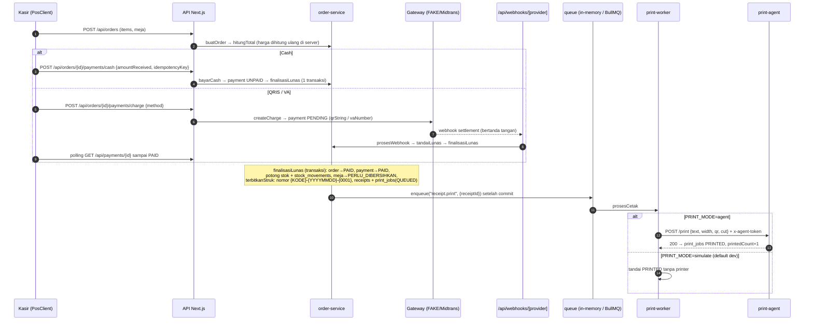
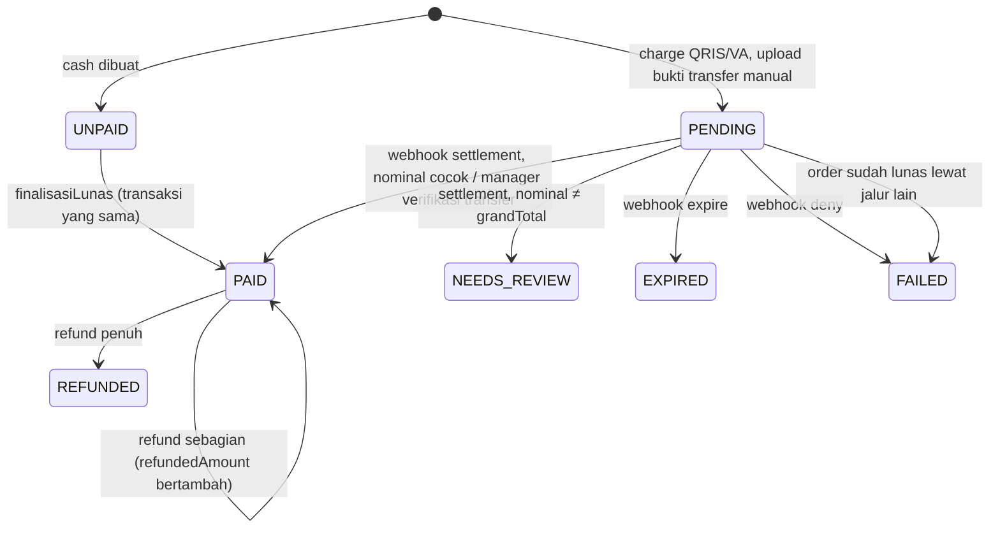

# Arsitektur KasirKu

Next.js 15 (App Router) melayani UI dan API dalam satu proses. Data lewat Prisma (SQLite saat dev, Postgres di production). Pekerjaan async (cetak struk, notifikasi) lewat `src/lib/queue.ts`. Printer fisik dijangkau lewat print agent lokal (`print-agent/`).

```
Browser kasir (PWA)                Server Next.js                          Komputer kasir
┌──────────────────┐  fetch   ┌──────────────────────────────┐  HTTP   ┌──────────────────┐
│ /pos  PosClient   │────────▶│ src/app/api/**  (route+Zod)   │───────▶│ print-agent :9100 │──▶ printer thermal
│ Dexie (offline)   │         │ src/lib/order-service.ts      │        └──────────────────┘    (tcp / USB / share)
│ sw.js (aset)      │         │ src/lib/payments/*            │
└──────────────────┘         │ src/lib/queue.ts ── worker    │◀── webhook ── Payment gateway (Midtrans / FAKE)
                             │ Prisma ── SQLite | Postgres   │
                             └──────────────────────────────┘
```

## Alur order → bayar → struk → cetak



Catatan akurasi terhadap kode:

- "payment.paid" bukan event/job terpisah. Lunas = fungsi `finalisasiLunas` di `order-service.ts`, dan struk terbit **di transaksi yang sama** (`terbitkanStruk` di `receipt.ts`) supaya nomor struk tidak bolong dan tidak ada order PAID tanpa struk.
- Tidak ada job `receipt.generate` terpisah: struk dibuat sinkron di transaksi pelunasan (lebih aman untuk nomor urut). Job yang aktif: `receipt.print` dan `notification.push` (dipasang di `src/instrumentation.ts` → `pasangWorkerCetak`).
- Polling `GET /api/payments/[id]` (5 detik selama 2 menit) hanya membaca status di DB. Penanyaan ulang ke gateway dilakukan cron rekonsiliasi `src/lib/reconcile.ts` tiap 5 menit (Midtrans `GET /v2/{transaction_id}/status`; semua provider: charge lewat `expiresAt` → EXPIRED).
- `POST /api/dev/simulate` membuat payload webhook FAKE bertanda tangan lalu memanggil `prosesWebhook` yang sama dengan webhook publik. Hanya untuk provider `FAKE`.
- Cetak ulang (`POST /api/receipts/[id]/print` → `cetakUlang`) membuat print job baru; struk dengan `printedCount > 0` dicetak dengan label `*** REPRINT ***`. Nomor struk tidak berubah.

## State machine

### Payment (`payments.status`)



### Order (`orders.status`)

`DRAFT → CONFIRMED → PAID → REFUNDED | PARTIALLY_REFUNDED`, dan `DRAFT | CONFIRMED → CANCELLED`. Order `PAID` tidak bisa diubah atau dibatalkan (pakai void/refund). `needsReview=true` ditandai saat nominal webhook tidak cocok.

## Idempotensi & out-of-order guard

| Risiko | Penjaga | Lokasi |
|---|---|---|
| Webhook dikirim ulang gateway | `payment_events.providerEventId` UNIQUE; dicek dulu, lalu event "diklaim" dengan insert sebelum efek samping apa pun. Insert gagal (balapan) → balas `duplicate` | `webhook-service.ts` |
| Signature palsu | `verifyWebhook` (FAKE: HMAC-SHA256 `PAYMENT_FAKE_SECRET`; Midtrans: SHA-512 `order_id+status_code+gross_amount+serverKey`) → 401, tidak ada baris tersimpan | `payments/fake.ts`, `payments/midtrans.ts` |
| Event untuk order tak dikenal | Matching wajib `providerRef` **dan** `orderNo`. Tidak cocok → disimpan di `orphan_events` (tidak dobel saat retry) untuk rekonsiliasi | `webhook-service.ts` |
| Nominal tidak sama | `NEEDS_REVIEW` + `orders.needsReview` + job `notification.push`; order tidak menjadi PAID | `webhook-service.ts` |
| `expire` tiba setelah `settlement` | Diabaikan bila payment sudah PAID | `webhook-service.ts`, `tandaiExpired` |
| Dua pembayaran untuk satu order | Optimistic lock `updateMany where status in (DRAFT, CONFIRMED)`; kalah → payment kedua `FAILED` | `finalisasiLunas` |
| Klik bayar cash dua kali | `idempotencyKey` → `providerRef = cash_<key>`; request kedua mengembalikan payment yang sama | `bayarCash` |
| Struk ganda | Satu order maksimal satu struk `SALE`; nomor dari `receipt_sequences` (upsert increment per outlet per hari) di transaksi yang sama | `receipt.ts` |
| Sinkronisasi offline ganda | `orders.clientRef` UNIQUE; sync kedua mengembalikan order yang sama (`duplicate`) | `sinkronOrderOffline` |
| Printer mati | Print job tetap di DB (`QUEUED/FAILED`), queue retry 5× dengan backoff eksponensial, lalu bisa cetak ulang manual | `print-worker.ts`, `queue.ts` |

Semua skenario webhook di atas diuji terhadap SQLite sungguhan di `src/lib/__tests__/webhook.test.ts`.

## Offline mode

- `src/lib/offline.ts` (Dexie, DB IndexedDB `kasirku-offline`): saat offline, POS menyimpan **order cash** beserta `clientRef` (UUID) dan uang diterima, lalu menampilkan struk sementara bernomor `OFFLINE-xxxxxxxx`.
- Saat event `online`, `sinkronAntrean()` mengirim antrean berurutan ke `POST /api/orders/sync`. Server menghitung ulang harga (`buatOrder`), lalu `bayarCash` dengan idempotency key `offline_<clientRef>`, sehingga struk resmi terbit dengan nomor normal. Yang sukses dihapus dari antrean, yang ditolak (mis. shift belum dibuka) ditandai `FAILED` dan tetap tersimpan.
- QRIS/VA tidak pernah diantrekan karena butuh gateway.
- Service worker `public/sw.js` meng-cache aset `/_next/static/*` dan ikon (cache-first), navigasi network-first dengan fallback halaman `/pos` yang terakhir dibuka. `/api/*` tidak pernah di-cache. Didaftarkan oleh `src/components/RegisterSW.tsx` (production, atau `NEXT_PUBLIC_SW=1`).

## Dev vs production

| Aspek | Dev lokal | Production |
|---|---|---|
| Database | SQLite `file:./data/kasirku.db` (relatif ke `prisma/` → `prisma/data/kasirku.db`) | Postgres: ubah `provider = "postgresql"` di `prisma/schema.prisma`, set `DATABASE_URL`, jalankan `prisma db push` / migrate. `docker-compose.yml` menyediakan `postgres:16` |
| Queue | In-memory (`REDIS_URL` kosong): retry 5×, job hilang saat restart | BullMQ (`REDIS_URL` diisi, `redis:7` di compose). Worker saat ini jalan di proses web yang sama; pisahkan ke proses sendiri bila beban naik |
| Pembayaran | `PAYMENT_PROVIDER=fake` + `/api/dev/simulate` | `PAYMENT_PROVIDER=midtrans`, webhook ke `/api/webhooks/midtrans` |
| Cetak | `PRINT_MODE=simulate` | `PRINT_MODE=agent` + print agent di tiap kasir |

Catatan SQLite: tipe kolom JSON disimpan sebagai string (`taxConfig`, `payloadJson`), dan pencarian `contains` di SQLite case-insensitive hanya untuk ASCII. Di Postgres pencarian produk menjadi case-sensitive kecuali ditambah `mode: "insensitive"`.

## Test

- `npm test` (Vitest): `money` (urutan pajak/service/pembulatan), `struk` (lebar 32/48, REPRINT), `webhook` (idempotensi terhadap `prisma/data/test.db` yang dibuat ulang tiap run), encoder ESC/POS print agent.
- `npm run e2e` (Playwright, Chrome terpasang): alur kasir cash & QRIS lewat API terhadap `npm run dev` dengan data seed.
